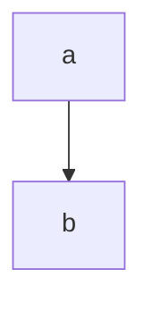

Text before the first heading belongs to no section.

## Getting started

A paragraph with *emphasis*, **strong**, ~~struck~~, ~single~ and `inline code`.
A soft break, then a hard break\
and an [external link](https://example.com/a?b=1 "Example"), an autolink
<https://example.org/x> and a bare www.example.net link. Entities: &amp; &copy;.

1. first
2. second
   - nested *a*
   - nested b

3) loose start
4) after a blank line

- one

- two

> A plain quote.
> Still the quote.

***

| Left | Centre | Right | None |
|:-----|:------:|------:|------|
| a | **b** | `c` | |
| 1 | 2 | 3 | 4 |

```python title="server/app.py" #app-code
def main():
    return 1
```

```
plain fence, no language
```

```text
  +--+
  |  |
  +--+
```

    indented code



### Getting started

#### Deep dive {#deep}

Setext heading two
------------------

## Sources

## !!!

## Closing ##
